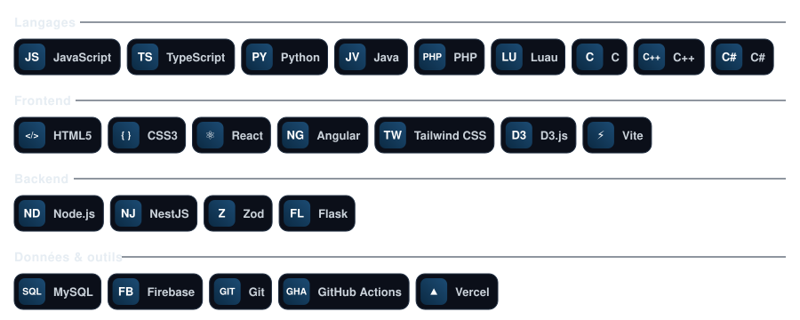
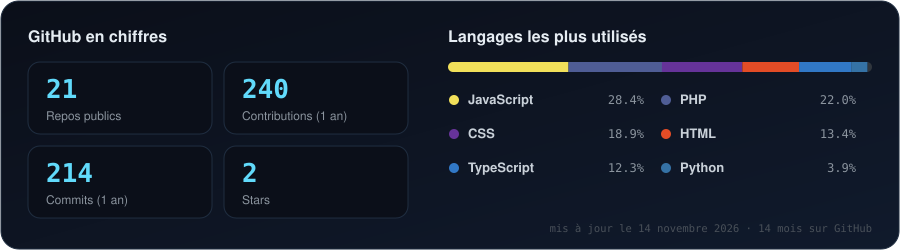

### Building things that feel alive.

**Développeur Full-Stack** · React / TypeScript / NestJS · Créateur de jeux et d'expériences web

De l'architecture backend aux interfaces qui donnent envie de cliquer.

 

## `01 / ABOUT ME`

Étudiant en **3ᵉ année de BUT MMI, parcours Développement Web**, à l'IUT de Bobigny, je construis des applications et des jeux où **technique, design et expérience utilisateur** se rencontrent.

Après **5 mois chez Hermès Digital** (avril–août 2026), j'ai notamment travaillé avec **NestJS, TypeScript, Zod et React** sur des fonctionnalités backend, des tests et de la maintenance applicative.

> **Objectif :** une alternance d'un an en développement web full-stack. J'aime les projets ambitieux, le code maintenable et les idées un peu folles.

## `02 / FEATURED WORK`

| Projet | Ce que j'y explore | Explorer |
|:--|:--|:--|
| **Mathdle** | Un jeu de réflexion mathématique, avec un mode programmation en préparation | [Jouer](https://mathdlee.vercel.app) · [Code](https://github.com/alnrfLO/mathdle) |
| **Portfolio** | Identité visuelle, web et présentation de mes créations | [Visiter](https://rafatns.vercel.app) · [Code](https://github.com/alnrfLO/Portfolio) |
| **Poker** | Texas Hold'em interactif | [Jouer](https://poker-murex-seven.vercel.app) · [Code](https://github.com/alnrfLO/poker) |
| **chaos_mode** | Expérimentation et modding Minecraft en Java | [Code](https://github.com/alnrfLO/chaos_mode) |

<b>+ Ouvrir le reste de mon univers</b>

- [Codex du Voyageur](https://github.com/alnrfLO/alnrflo-dashboard) — dashboard gaming avec Three.js.
- [Que regarder ce soir ?](https://que-regarder-ce-soir.vercel.app) — découverte de films via TMDB.
- [MCU Watchlist](https://github.com/alnrfLO/mcu-watchlist) — suivi de visionnage React / Vite.
- [SAÉ 401](https://github.com/alnrfLO/SAE401) — plateforme web PHP / MySQL.
- [Blackjack](https://github.com/alnrfLO/Blackjack) — Python et Flask.
- [Pong](https://github.com/alnrfLO/pong) · [Snake](https://github.com/alnrfLO/snake) · [Tetris](https://github.com/alnrfLO/tetris) · [Morpion](https://github.com/alnrfLO/tictactoe).

## `03 / TECH STACK`

**Ce que j'aime particulièrement :** TypeScript · React · Node.js · NestJS · conception d'interfaces · jeux.

## `04 / CURRENT QUESTS`

- 🧩 **Mathdle** — mode programmation : Java, C++, Python, JavaScript.
- 🎮 **Roblox** — prototype mêlant gacha, tower defense et combat au tour par tour (Luau + Rojo).
- ⚔️ **Minecraft** — nouvelles idées autour de `chaos_mode`.
- 💼 **Prochaine étape** — une alternance full-stack.

## `05 / GITHUB ACTIVITY`

Built with curiosity, caffeine & a lot of commits.

