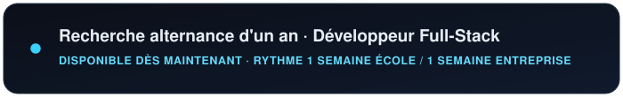
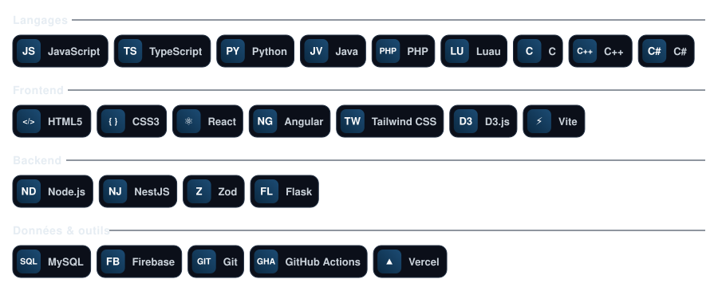

  

  

 

### 👋 Profil

Développeur full-stack en **3ᵉ année de BUT MMI** (parcours Développement Web) à l'IUT de Bobigny. Après **5 mois de stage backend chez Hermès** sur du NestJS / TypeScript, je cherche une **alternance d'un an** pour continuer à construire des produits complets, du back au front.

À côté, je code beaucoup pour moi : jeux, outils, sites… c'est comme ça que j'apprends le plus vite.

### 🎯 En ce moment

- 🧮 **Mathdle** : j'ajoute un mode Programmation (Java, C++, Python, JS) au jeu
- 🎮 **Un jeu Roblox** gacha × tower defense, avec un combat au tour par tour inspiré de Honkai: Star Rail (Luau + Rojo)
- ⚔️ **chaos_mode** : la suite de mon mod Minecraft en Java
- 📨 Des candidatures pour une **alternance** en développement web

### 💼 Expérience

**Assistant Software Engineer (stage)** · Hermès Digital, Paris · `avr. → août 2026`

- Développement de fonctionnalités backend en **Node.js / NestJS / TypeScript**
- Migration de schémas de validation vers **Zod**
- Tests unitaires, fonctionnels et d'intégration
- Développement front-end en **React**
- Refactoring et optimisation d'applications existantes, code reviews, rituels Agile

**Avant le code** : animateur sportif (Ville de Bobigny) et manœuvre bâtiment, deux expériences de terrain qui m'ont appris la rigueur, l'autonomie et le travail en équipe. Le détail est sur mon [CV](https://rafatns.vercel.app/assets/CV_Rafael_Antunes_oliveira.pdf).

### 🚀 Projets à la une

Code source : [mathdle](https://github.com/alnrfLO/mathdle) · [Portfolio](https://github.com/alnrfLO/Portfolio) · [poker](https://github.com/alnrfLO/poker) · [chaos_mode](https://github.com/alnrfLO/chaos_mode) · [yofukashi-no-uta](https://github.com/alnrfLO/yofukashi-no-uta) · [SAE303](https://github.com/alnrfLO/SAE303)

<b>📂 Autres projets</b>

 

| Projet | Ce que c'est | Stack |
|---|---|---|
| 🎮 [Codex du Voyageur](https://github.com/alnrfLO/alnrflo-dashboard) | Dashboard gaming perso : LoL, Valorant, TFT, Genshin, Star Rail, Wuthering Waves | HTML · CSS · JS · Three.js |
| 🎬 [Que regarder ce soir ?](https://github.com/alnrfLO/que-regarder-ce-soir) | Trouver un film via l'API TMDB : filtres, mode aléatoire, suggestions par humeur · [démo](https://que-regarder-ce-soir.vercel.app) | JavaScript · API TMDB |
| 🦸 [MCU Watchlist](https://github.com/alnrfLO/mcu-watchlist) | Suivre son visionnage du MCU avant *Avengers: Doomsday*, sans compte ni backend | React · Vite |
| 🏫 [SAÉ 401](https://github.com/alnrfLO/SAE401) | Plateforme web en MVC : spots, profils, commentaires, messagerie, agenda | PHP · MySQL |
| 🃏 [Blackjack](https://github.com/alnrfLO/Blackjack) | Du terminal à une app web Flask, avec système de mises | Python · Flask |
| 🕹️ Mini-jeux | [Pong](https://github.com/alnrfLO/pong) · [Snake](https://github.com/alnrfLO/snake) · [Tetris](https://github.com/alnrfLO/tetris) · [Morpion](https://github.com/alnrfLO/tictactoe) | Python · Pygame · Tkinter |

### 🛠️ Compétences

### 📊 GitHub

  

 

